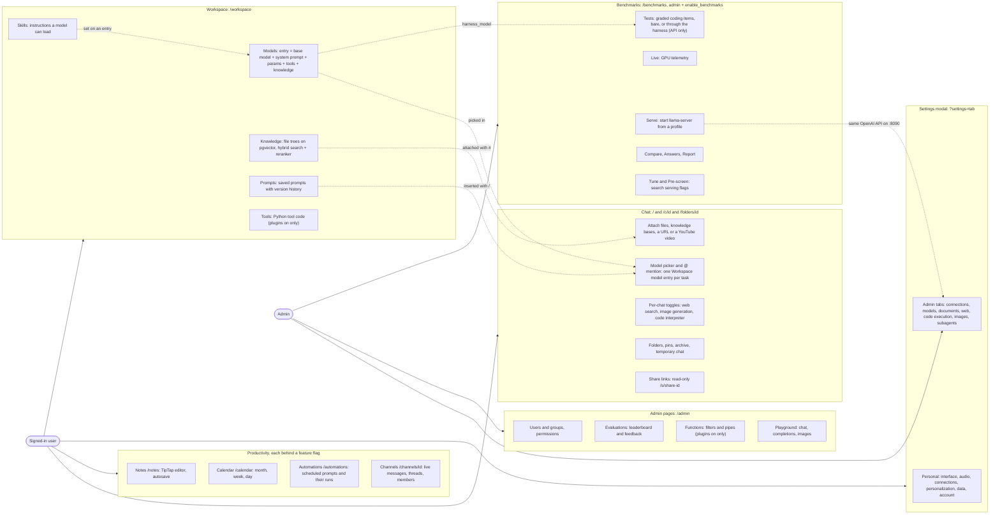
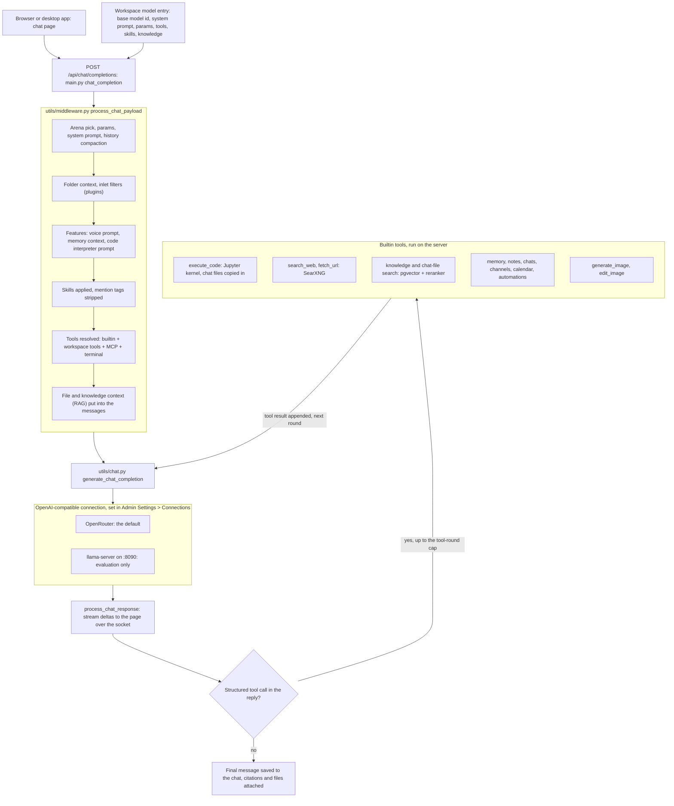
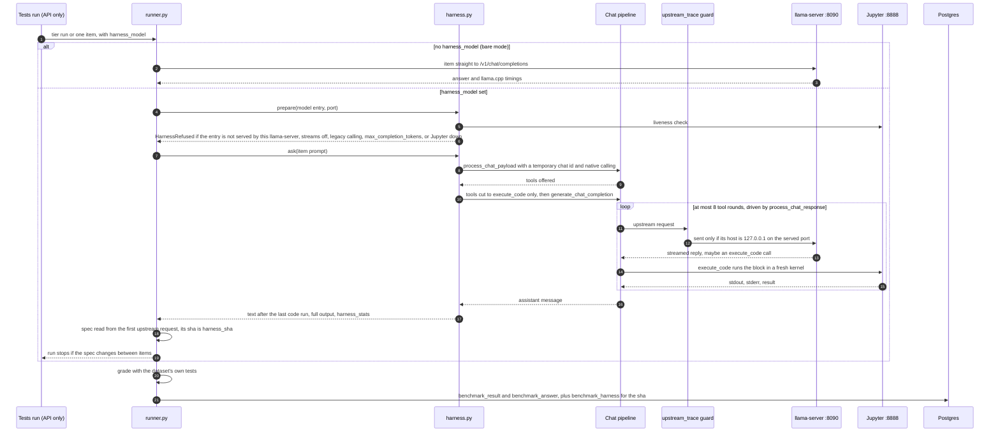

# Features and the model harness

An overview of what a user can do in the app, how a chat message reaches
a model, and how the benchmark harness scores the assistant as deployed.
It is written from `main` at `3093ffb1` (2026-11-08). It summarises and
links; the details live in the guides it points to, and every page and URL
is listed in [README.md's Pages and URLs](../../README.md#pages-and-urls).

The diagrams are Mermaid. Each `.mmd` file beside this one is the canonical
source, and the fenced copy here is byte-identical to it, the same
arrangement as [ROADMAP.md](../ROADMAP.md) and `roadmap-timeline.mmd`. Edit
the `.mmd` file, then paste it here unchanged.

## Feature map

Canonical source: [`features-map.mmd`](features-map.mmd).

### Chat

The page at `/` (a saved chat at `/c/<id>`, a new chat in a folder at
`/folders/<id>`).

- **Models.** The picker, or `@` in the input, chooses a Workspace model
  entry. Each entry wraps one connection model with its own system prompt
  and params; the entries in use are in
  [README.md's Model setup](../../README.md#model-setup).
- **Context.** Upload files, attach a knowledge base with `#`, insert a
  saved prompt with `/`, or open a chat with `?load-url=` or `?youtube=`.
- **Tools.** Per-chat toggles for web search, image generation and the code
  interpreter. With native function calling (the default) they are tools
  the model chooses to call; see
  [How a chat reaches a model](#how-a-chat-reaches-a-model).
- **Organising.** Folders, pins, archive, temporary chats
  (`?temporary-chat=true`, nothing saved) and read-only share links at
  `/s/<share-id>`.
- **Memory.** With memory on, saved memories are added to the system
  context. The background review that writes memories every tenth turn is
  configured but has not yet been seen working end to end
  ([assistant-tools.md](assistant-tools.md#memory-background-review)).

### Workspace (`/workspace`)

Each section needs its permission; an admin sees all of them.

| Section | What it holds |
|---|---|
| Models | Model entries: base model, system prompt, params, default tools, skills, knowledge, capabilities |
| Knowledge | Knowledge bases as file trees with uploads and folder sync, embedded with `BAAI/bge-m3` and searched hybrid (BM25 + vector) with a reranker ([assistant-tools.md](assistant-tools.md#knowledge-retrieval)) |
| Prompts | Saved prompts with version history |
| Skills | Instructions a model entry carries, loaded by the model when it needs them |
| Tools | Python tool code; hidden when the backend has plugins off |

### Notes, calendar, automations, channels

Each is behind a feature flag (`enable_notes`, `enable_calendar`,
`enable_automations`, `enable_channels`) and, for a non-admin, a
permission.

| Page | What it does |
|---|---|
| `/notes` | A TipTap editor with autosave; a chat about a note sees the note |
| `/calendar` | Month, week and day views; event alerts come from the backend's scheduler |
| `/automations` | Prompts run on a schedule (an RRULE), with each run listed |
| `/channels/<id>` | Live messages, threads, reactions, pins and members |

The assistant can also reach these through its builtin tools (search
notes, create an automation, look up calendar events, and so on).

### Settings

Settings is a modal, opened from any page with `?settings=<tab>`.
Personal tabs cover the interface, audio, notifications, connections,
integrations, personalization, data controls, archived chats and the
account. An admin also gets `?settings=admin:<tab>`, where the app is
configured: connections, models, documents (retrieval), web search, code
execution, images, audio, subagents, analytics and more. The full tab list
is in [README.md](../../README.md#signed-in).

### Admin pages (`/admin`)

| Page | What it does |
|---|---|
| Users | Users and groups, their permissions, CSV import |
| Evaluations | The leaderboard built from chat ratings, and the feedback table with export |
| Functions | Filters and pipes that run inside the chat pipeline; plugins on only |
| Playground | Chat, completions and image generation against any model, outside a saved chat |

### Benchmarks (`/benchmarks`)

Admin only, and only while `enable_benchmarks` is not `false`. It is where
local inference is evaluated; chat stays on OpenRouter until local
throughput is acceptable.

| Page | What it does |
|---|---|
| Serve | Starts `llama-server` from a serving profile on `:8090`, with GPU telemetry recording |
| Live | The run being recorded, refreshed every 5 s |
| Tests | Graded items from HumanEval+, MBPP+, DS-1000 and LiveCodeBench, sent bare or through the harness (below) |
| Compare, Answers, Report | Pass rate and passes per minute by configuration, the stored answers, and the statistical report |
| Tune, Pre-screen | Search serving flags: a served round-elimination sweep, and a llama-bench Optuna study |

Details: [benchmarks.md](benchmarks.md), [llama-cpp.md](llama-cpp.md),
[telemetry.md](telemetry.md).

### Desktop app

The Electron app loads the same pages from the server, so it has every
feature above and none of its own; it starts and stops the stack when
nothing is running. See [desktop.md](desktop.md).

## How a chat reaches a model

Canonical source: [`features-chat-pipeline.mmd`](features-chat-pipeline.mmd).

- **One path for every model.** A chat names a Workspace model entry; the
  backend merges the entry's system prompt and params into the request and
  sends it to whichever OpenAI-compatible connection serves the entry's
  base model. OpenRouter is that connection today. Pointing chat at local
  inference is a change to the connection's base URL and API key in Admin
  Settings > Connections, nothing more.
- **Preparation** happens in `process_chat_payload`
  (`apps/server/local_llm/utils/middleware.py`): the system prompt, history
  compaction, inlet filters, memory context, skills, the tool list, and
  retrieved file and knowledge context.
- **Native function calling** is the default: web search, image generation,
  knowledge search and code execution are offered as builtin tools, and the
  model decides when to call them. The reply streams back to the page;
  each structured tool call runs on the server and its result goes back to
  the model for another round, up to `CHAT_RESPONSE_MAX_TOOL_CALL_ITERATIONS`
  (256 by default). Builtin tools are offered only to requests from the UI
  (they carry a socket session); a plain API caller gets only the tools it
  names.
- **Legacy function calling** (a per-model setting) instead runs web search
  and image generation up front, and lets a task model pick tool calls
  before the main request.
- **The code interpreter** runs on the Jupyter engine (`127.0.0.1:8888`), in
  a fresh kernel per block with the chat's uploaded files copied in. The
  inherited Pyodide engine does not work in this app.
  [assistant-tools.md](assistant-tools.md) covers Jupyter's sandbox,
  SearXNG and the retrieval models.

## The model harness

Canonical source: [`features-harness.mmd`](features-harness.mmd).

A Tests run measures either the bare model or the assistant as deployed.

- **Bare mode** (the default). Each item goes straight to `llama-server`'s
  `/v1/chat/completions`, optionally behind one of the system prompts in
  `benchmarks/data/prompts/`. It measures the model.
- **Harness mode.** With `harness_model` set to a Workspace model entry,
  `benchmarks/evaluation/harness.py` sends each item through the chat
  pipeline above: the entry's system prompt and params, native function
  calling, and the code interpreter on Jupyter. It uses a `temporary:` chat
  id, so no chat, title or memory is written, and it cuts the tools offered
  to `execute_code` alone. It measures the assistant.

What keeps a harness result trustworthy:

- **It refuses before it starts** when the entry is not served by the
  `llama-server` being measured, its base model is missing, it turns
  streaming off, uses legacy function calling or sets
  `max_completion_tokens`, or Jupyter does not answer.
- **Every upstream request is checked** (`utils/upstream_trace.py`): one
  bound for anywhere but `127.0.0.1:<port>` is stopped before it is sent,
  and nothing is recorded.
- **The run is fingerprinted.** `harness_sha` is a sha of what every item
  shares, read back from the first request actually sent upstream (the
  entry, the system message, the tools, every param, the 8-round limit).
  It sits beside `system_sha` as a grouping key, and a run whose request
  changes between items stops. Like the system prompt, it is not part of
  `config_id`.
- **Only the final answer is graded**: the text after the last code run,
  graded by the dataset's own tests, as in bare mode. The whole output is
  kept in `benchmark_answer.output`, and `harness_stats` records the
  rounds, code runs and output tokens in place of llama.cpp's timings.

Where it stands:

- It is reachable through the API only (`POST /api/v1/benchmarks/tests/run`
  or `/item` with `harness_model`). The Tests page has no switch for it yet,
  and Compare and Report leave harness rows out until they group by
  `harness_sha`; both are planned in PR 2 of
  [the plan](../plans/benchmarks-through-the-app.md).
- It needs a model that makes structured tool calls. `qwen25c` writes its
  `execute_code` call as JSON text, so no code runs and a harness run on it
  measures the bare model plus the entry's prompt. `qwen38` makes the
  structured call. `harness_stats.code_runs` tells the two apart.

The full rules and what each recorded field means are in
[benchmarks.md's harness section](benchmarks.md#through-the-app-harness-mode).
